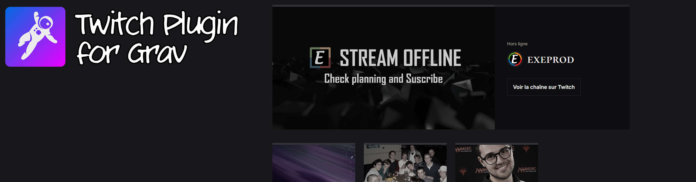
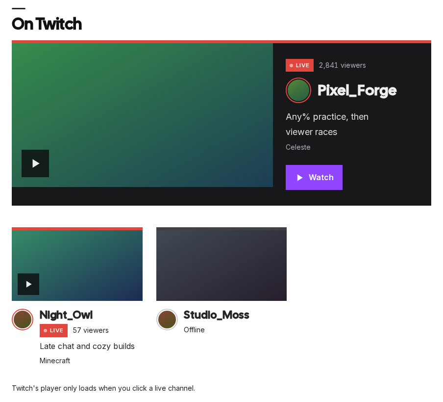
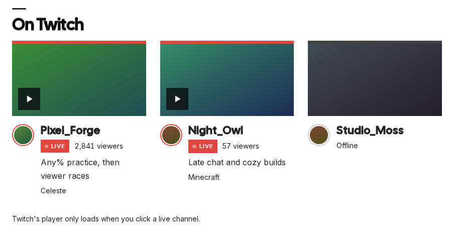

# Twitch Live



[](https://github.com/Exe64/grav-plugin-twitch-live/actions/workflows/ci.yml)

Grav plugin: the Twitch channels you choose, live ones first, with the stream preview, avatar, title,
game and viewer count. The Twitch player loads in the page only when the reader clicks a live channel.
Used on [magicthegathering.fr](https://magicthegathering.fr).

| One featured | Card grid |
|---|---|
|  |  |

## Installation

Requires Grav 2.2+ and the [shortcode-core](https://github.com/getgrav/grav-plugin-shortcode-core) plugin (installed with it by gpm).

```
bin/gpm install twitch-live
```

Manual install: copy this repository to `user/plugins/twitch-live`, and install `shortcode-core`.

## Twitch credentials

The plugin asks Twitch for the live status and the channel images with an app token.

1. In the [Twitch developer console](https://dev.twitch.tv/console/apps), register an application
   (category *Website Integration*, OAuth redirect URL `http://localhost`: it is not used).
2. Copy its *Client ID*, create a *Client secret*, and enter both in the plugin's settings in the Admin.

They are stored in `user/config/plugins/twitch-live.yaml`; the Admin never sends the secret back to the
browser. Without credentials Twitch is never asked: the channels show with their initial, no status.

## Usage

Set the channels, the presentation and the featured channel in the Admin, then place the block:

- in a page, with the shortcode; each parameter left out is taken from the Admin:

  ```
  [twitch]
  [twitch layout=compact channels="channel_one, channel_two"]
  [twitch layout=feature feature=chosen feature_channel=channel_one]
  ```

- in a theme template:

  ```twig
  
  ```

| `layout` | Shows |
|---|---|
| `grid` | 16:9 cards: stream preview when live, else the channel's offline image or avatar |
| `compact` | one line per channel: avatar, name, status, title |
| `feature` | one channel large (live: *Watch* opens the player; offline: its offline image and a link to the channel), the others as cards below |
| `strip` | the cards on one row that scrolls sideways (finger, wheel, previous/next buttons) |

| `feature` | Featured channel |
|---|---|
| `top` | the most watched live channel, else the first of the list |
| `random` | drawn at each page view among the live channels, else among all |
| `chosen` | `feature_channel`, shown even when offline |

Several blocks can share a page; each has its own player. Shortcodes are processed before Markdown,
code included: to show the syntax itself in a page, wrap it in shortcode-core's `[raw]…[/raw]`.

## Language

Texts in English and French (`languages.yaml`), in the site language: on a single-language French
site, set *Supported languages* to `fr` in the Admin's system configuration (with *Include default
language* off, URLs stay the same). Without any language set, Grav uses English.

## Theming

The block carries its own classes (`.twitch`, `.tw-*`) and nothing from the theme. A theme can:

- set the `--tw-*` custom properties, on `.twitch` or above: `--tw-band`, `--tw-band-line`,
  `--tw-on-band`, `--tw-on-band-soft`, `--tw-on-band-muted` (dark bands: feature, player),
  `--tw-accent`, `--tw-accent-hover`, `--tw-on-accent` (buttons), `--tw-line`, `--tw-ink`,
  `--tw-ink-strong`, `--tw-muted`, `--tw-link`, `--tw-focus`, `--tw-paper`, `--tw-head-font`,
  `--tw-ease`, `--tw-live` (live red). Without them: Twitch's dark palette for the bands, the page's
  own text colour and font elsewhere;
- add its classes to the section, its inner block and its heading:

  ```twig
  
  ```

- override the whole markup with its own `templates/partials/twitch-live.html.twig`.

## How it works

- Status (`/streams`) and channel images (`/users`) from the Helix API, one request per endpoint for
  all the channels of a block. Cached on the server: status for *Status freshness* seconds (120 by
  default), channel images for a day, the token until shortly before it expires. A failure is cached
  for 60 seconds and logged as a warning; the channels then show without status.
- The shortcode leaves a placeholder in the page content, replaced by the block on each request:
  Grav's page cache never freezes the live status or the random pick.
- Images are loaded by the reader's browser from Twitch's CDN (`static-cdn.jtvnw.net`, no referrer,
  no cookie); any other image address from the API is dropped. The player (and its cookies) loads
  only on click, above the channels, one at a time per block, with `parent` set to the current host
  name as Twitch requires. Ctrl, Cmd or middle click keeps the plain link. Without JavaScript every
  name is a link to the channel on twitch.tv.

Code under the MIT licence. Twitch is a trademark of Twitch Interactive, Inc.; this plugin is not
affiliated with Twitch.
